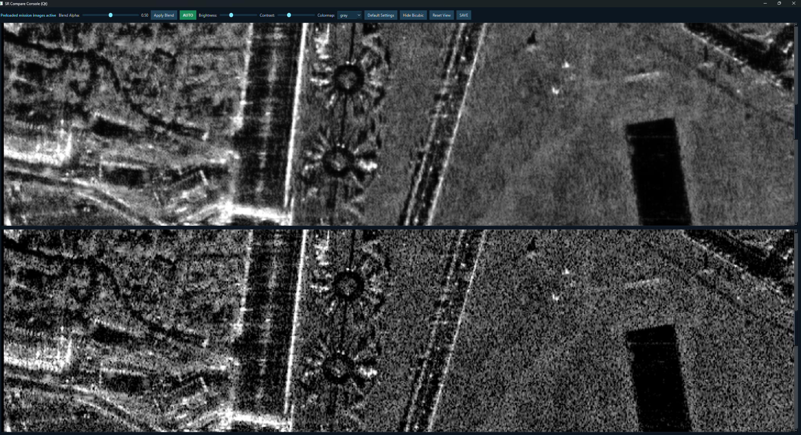
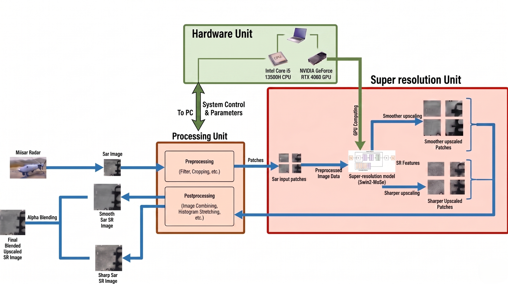
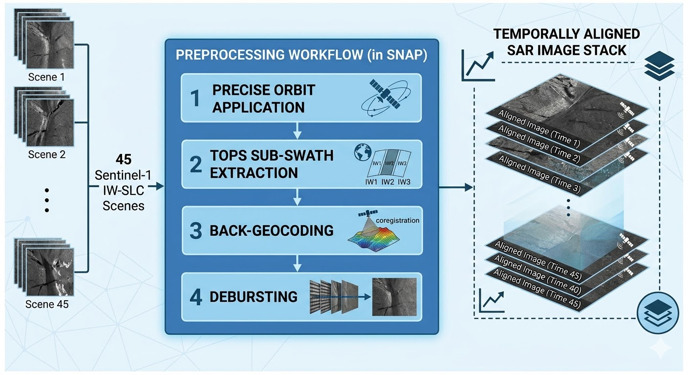
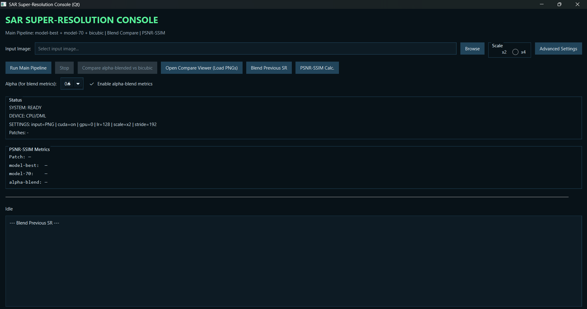
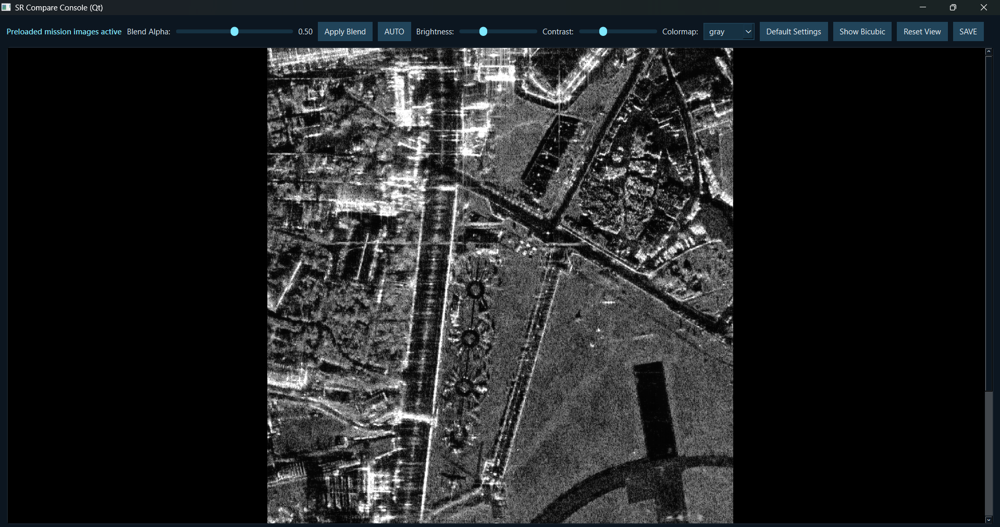
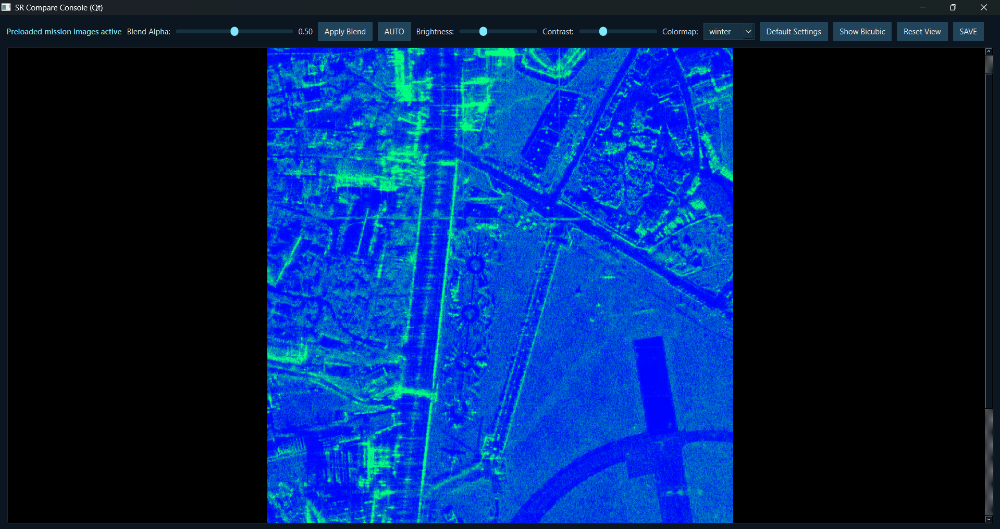

# SAR Image Super-Resolution

A Bilkent University Electrical and Electronics Engineering senior design project developed in collaboration with **Meteksan Defense (Meteksan Savunma)**. The team built a desktop prototype for enhancing single-channel synthetic aperture radar (SAR) imagery at **×2 and ×4**. The application lets an operator explore the trade-off between retaining fine detail and suppressing speckle.

This is a **documentation-only case study** based on the team’s May 2026 Committee Meeting 4 report (CM4). The application, implementation code, model weights, and datasets are not distributed here. Meteksan and the project team approved this case study and the six included report figures for publication.

*Super-resolved output (top) and bicubic interpolation (bottom).*

## Key Technical Contributions

- Adapted an upstream Swin2-MoSE checkpoint to single-channel SAR through selective fine-tuning.
- Built paired training data from multitemporal Sentinel-1 imagery and synthetic low-resolution degradation.
- Combined sharper and smoother checkpoints through manual alpha fusion and automatic per-patch weighting.
- Integrated overlapping-patch inference and a synchronized bicubic comparison into an offline desktop console.

[Results](#reported-results) | [Architecture](#architecture) | [Dataset preparation](#dataset-preparation) | [Training](#training-and-checkpoints) | [Alpha fusion](#alpha-fusion) | [Desktop GUI](#desktop-gui-and-inference) | [Limitations](#limitations) | [Credits](#credits-and-sources)

Captions and source pages are recorded in the [figure register](figures/README.md).

## Reported results

| Swin2-MoSE configuration | PSNR | SSIM |
| --- | ---: | ---: |
| Sharper, upstream pretrained weights | 22.0536 dB | 0.3596 |
| Smoother, freeze-tuned on synthetic SAR pairs | 24.1380 dB | 0.6193 |

CM4 §4.2.2 reports PSNR and SSIM for the individual checkpoints. The blended output shown above is a qualitative comparison with bicubic interpolation.

| Runtime measurement | Value reported in CM4 §5.1 |
| --- | --- |
| 256 × 256 input at ×2 on an RTX 4060 Ti | 2 seconds on average across 20 runs |
| Batch throughput at ×2 | 1,800 tiles/hour |
| Batch throughput at ×4 | 1,440 tiles/hour |

The throughput is a separate reported measure. CM4 does not give a standalone ×4 latency measurement or runtime variability.

## Architecture

Coherent radar imaging produces granular, multiplicative speckle. Increasing pixel density through super-resolution can make edges and bright scattering features easier to inspect, but a learned reconstruction can suppress real returns or introduce apparent detail. The ×2 and ×4 options multiply both output dimensions. They describe the output sampling grid and do not establish an equivalent gain in physical sensor resolution.

**Swin2-MoSE** is the remote-sensing super-resolution architecture introduced by Leonardo Rossi and coauthors. It combines shallow feature extraction, shifted-window transformer processing with mixture-of-experts feed-forward layers, and a pixel-shuffle reconstruction head. CM4 credits the upstream work for the architecture and its NCC, SSIM, and MoE loss formulation. The senior design team selected and adapted the model for SAR, built a multitemporal training dataset, combined two checkpoints, and integrated inference and comparison into the desktop console. [Swin2-MoSE, CM4 bibliography ref. 38](#credits-and-sources)

*System architecture and processing flow.*

## Dataset preparation

The team used **45 Sentinel-1 IW-SLC acquisitions** over the same area with matching orbit and imaging geometry. The SNAP workflow applied precise orbit information, selected TOPS sub-swaths, co-registered acquisitions by back-geocoding, and debursted the images. Temporal averaging produced a lower-speckle intensity reference. This was the working high-resolution target, with residual speckle possible.

To synthesize the corresponding low-resolution input, the team applied a windowed-sinc low-pass point-spread function, downsampled for the target scale, and injected multiplicative gamma speckle. This produced **4,500 paired samples** with **256 × 256 HR patches**, as reported in CM4 §4.2.2. The multitemporal reference and synthetic degradation provide paired supervision. Their fidelity to real sensor degradations remains a limitation. [Sentinel-1 and SNAP references](#credits-and-sources)

*Sentinel-1 preprocessing in ESA SNAP.*

## Training and checkpoints

| Output | Configuration described in CM4 |
| --- | --- |
| Sharper | Uses the upstream checkpoint pretrained on optical SEN2VENµS imagery. It retains more visible high-frequency detail and also retains more speckle. |
| Smoother | Starts from the upstream model and fine-tunes on synthetic Sentinel-1 pairs. The team reinitialized the input convolution for one channel, froze the first three residual Swin Transformer blocks and normalization layers, and trained the last block and selected input, body, and reconstruction layers. |

The report lists NCC in the training summary and describes the retained NCC/SSIM/MoE formulation in §4.2.3. The precise per-run loss weighting is unspecified.

## Alpha fusion

The manual blend computes a pixelwise weighted sum of the two reconstructed outputs: **I_blend = α I₁ + (1 − α) I₂**, where **0 ≤ α ≤ 1**. The automatic mode predicts a separate weight per patch with a CNN trained on **400 manually annotated patches**, then stitches the blended patches. CM4 does not establish a quantitative advantage for the automatic blend.

## Desktop GUI and inference

The offline **SAR Super-Resolution Console** loads a grayscale PNG or TIFF, lets the user choose ×2 or ×4, and runs processing in a background worker. The pipeline generates overlapping patches, applies the two scale-specific checkpoint paths, stitches the outputs, and produces a bicubic comparison. The comparison viewer synchronizes zoom and pan between the super-resolved and bicubic views, offers a manual blend slider or automatic patch weighting, and provides brightness, contrast, and colormap controls. The console reports progress and supports PNG output and JSON logging according to CM4.

CM4 §4.2.4 records packaging the console as a desktop executable. [Console and viewer figure inventory](figures/README.md)

*Desktop console with inference controls and job status. The command log is masked.*

*Comparison viewer in grayscale mode.*

*Comparison viewer with a false-color palette.*

## Limitations

- The reported PSNR and SSIM describe individual checkpoints. CM4 does not establish the evaluation split, scale, or sample count. It provides neither a blend score nor an independent comparison on real MILSAR ground truth.
- PSNR and SSIM alone cannot establish preservation of SAR scatterers or radiometric fidelity. Temporal averaging and synthetic noise may differ from deployment imagery.
- CM4 records qualitative review by Meteksan engineers. That review is distinct from independent operational validation.
- The report names PySide6 in §4.2.4 and PyQt6 in §5.1. The packaged build's Qt binding remains unverified.

## Credits and sources

- **Senior design team:** Arda Karaman, Yunus Emre Koçak, Ömer Faruk Akbay, Mehmet Paşa, Atahan Karabey, and Mohammadhassan Mahmodi. The report credits the work at team level.
- **Mentorship:** Dr. Vakur B. Ertürk (academic mentor), Ahmet Özdemir (company mentor), and Zeynep Ortahüner (teaching assistant).
- **Primary source:** C5 team, *Super Resolution SAR*, Committee Meeting 4 Report, Bilkent University, May 12, 2026. See §§3–5 and the figure register for page references.
- **Upstream model:** L. Rossi, V. Bernuzzi, T. Fontanini, M. Bertozzi, and A. Prati, *Swin2-MoSE: A New Single Image Super-Resolution Model for Remote Sensing*, 2024. [arXiv:2404.18924](https://arxiv.org/abs/2404.18924)
- **Data and processing references in CM4:** [Copernicus Sentinel-1, ref. 24](https://dataspace.copernicus.eu/data-collections/copernicus-sentinel-missions/sentinel-1), [Vitale, Ferraioli, and Pascazio, ref. 31](https://ricerca.uniparthenope.it/handle/11367/102474), and [ESA SNAP, ref. 32](https://step.esa.int/main/toolboxes/snap/).
